# Entity relationship diagram

Data model of the WebApp MVC application (`main` at commit `42e4ff3`, 2026-11-16). It was generated from the runtime model that EF Core builds from `SheetsDbContext`, so every key, type, nullability and delete rule matches the SQLite database (`SheetsDB.db`) that the migrations create.

## Diagram

Data types are the C# property types. The quoted text after each attribute gives the SQLite column type, any maximum length, and whether the column allows NULL. `PK` = primary key, `FK` = foreign key, `UK` = unique.

```mermaid
erDiagram
    Course |o--o{ Quest : "groups (Quest.CourseId)"
    User |o--o{ Quest : "creates (Quest.CreatorUserId)"
    Quest ||--o{ QuestQuestion : "contains (QuestQuestion.QuestId)"
    QuestQuestion ||--o{ QuestOption : "offers (QuestOption.QuestQuestionId)"
    User ||--o{ QuestCompletion : "completes (QuestCompletion.UserId)"
    Quest ||--o{ QuestCompletion : "is completed in (QuestCompletion.QuestId)"
    User ||..o{ DailyStreaks : "is active on (UserId as text, no FK)"

    User {
        int Id PK "INTEGER, NOT NULL, auto-increment"
        DateTime CreatedAt "TEXT, NOT NULL"
        bool IsAdmin "INTEGER, NOT NULL"
        DateTime LastSeenAt "TEXT, NULL"
        string Name "TEXT(50), NOT NULL"
        string PasswordHash "TEXT, NULL"
        int Points "INTEGER, NOT NULL"
        int QuizzesCompleted "INTEGER, NOT NULL"
        string StudyProgram "TEXT(100), NOT NULL"
        string Username UK "TEXT(30), NOT NULL"
    }
    Course {
        int Id PK "INTEGER, NOT NULL, auto-increment"
        string Code UK "TEXT(20), NOT NULL"
        string Description "TEXT(500), NULL"
        string Title "TEXT(100), NOT NULL"
    }
    Quest {
        int Id PK "INTEGER, NOT NULL, auto-increment"
        int CourseId FK "INTEGER, NULL"
        int CreatorUserId FK "INTEGER, NULL"
        DateTime CreatedAt "TEXT, NOT NULL"
        string Description "TEXT(500), NULL"
        string Difficulty "TEXT(30), NOT NULL"
        string Title UK "TEXT(100), NOT NULL"
    }
    QuestQuestion {
        int Id PK "INTEGER, NOT NULL, auto-increment"
        int QuestId FK "INTEGER, NOT NULL"
        string AcceptedAnswers "TEXT(500), NULL"
        string AcceptedCode "TEXT(1000), NULL"
        bool CaseSensitive "INTEGER, NOT NULL"
        string CorrectOptionId "TEXT(20), NULL"
        string Explaination "TEXT(1000), NULL"
        int Points "INTEGER, NOT NULL"
        int Position "INTEGER, NOT NULL"
        string Question "TEXT(1000), NOT NULL"
        string StartCode "TEXT(2000), NULL"
        string Type "TEXT(20), NOT NULL"
    }
    QuestOption {
        int Id PK "INTEGER, NOT NULL, auto-increment"
        int QuestQuestionId FK "INTEGER, NOT NULL"
        string OptionKey "TEXT(10), NOT NULL"
        string Text "TEXT(300), NOT NULL"
    }
    QuestCompletion {
        int Id PK "INTEGER, NOT NULL, auto-increment"
        int QuestId FK "INTEGER, NOT NULL"
        int UserId FK "INTEGER, NOT NULL"
        int Attempts "INTEGER, NOT NULL"
        int BestScore "INTEGER, NOT NULL"
        DateTime FirstCompletedAt "TEXT, NOT NULL"
        DateTime LastCompletedAt "TEXT, NOT NULL"
        int MaxScore "INTEGER, NOT NULL"
    }
    DailyStreaks {
        int Id PK "INTEGER, NOT NULL, auto-increment"
        DateOnly ActivityDate "TEXT, NOT NULL"
        string UserId "TEXT, NOT NULL"
    }
```

`DailyStreaks.UserId` holds the user's `Id` as text and has no foreign-key constraint, so the dashed line is a logical link the database doesn't enforce. The other lines are real foreign keys.

## Relationships and cardinalities

| Relationship | Cardinality | Foreign key | Required | On delete of the "one" side |
|---|---|---|---|---|
| Course → Quest | Course 0..1 — 0..* Quest | `Quest.CourseId` → `Course.Id` | No (nullable) | Set null: the rows are kept, the key is cleared |
| User → Quest | User 0..1 — 0..* Quest | `Quest.CreatorUserId` → `User.Id` | No (nullable) | Set null: the rows are kept, the key is cleared |
| Quest → QuestQuestion | Quest 1 — 0..* QuestQuestion | `QuestQuestion.QuestId` → `Quest.Id` | Yes | Cascade: the rows are deleted too |
| QuestQuestion → QuestOption | QuestQuestion 1 — 0..* QuestOption | `QuestOption.QuestQuestionId` → `QuestQuestion.Id` | Yes | Cascade: the rows are deleted too |
| Quest → QuestCompletion | Quest 1 — 0..* QuestCompletion | `QuestCompletion.QuestId` → `Quest.Id` | Yes | Cascade: the rows are deleted too |
| User → QuestCompletion | User 1 — 0..* QuestCompletion | `QuestCompletion.UserId` → `User.Id` | Yes | Cascade: the rows are deleted too |
| User → DailyStreaks | User 1 — 0..* DailyStreaks (logical) | `DailyStreaks.UserId` (text) holds `User.Id` | Not enforced | None: rows stay if the user is deleted |

Every foreign key has a matching index. The other indexes enforce uniqueness:

| Table | Unique index | Rule it enforces |
|---|---|---|
| Users | `IX_Users_Username` (Username) | Usernames are unique |
| Courses | `IX_Courses_Code` (Code) | Course codes are unique |
| Quests | `IX_Quests_Title` (Title) | Quest titles are unique |
| QuestCompletions | `IX_QuestCompletions_UserId_QuestId` (UserId, QuestId) | One completion row per user per quest |
| DailyStreaks | `IX_DailyStreaks_UserId_ActivityDate` (UserId, ActivityDate) | One activity row per user per day |

## Entities in detail

### User  (table `Users`, `DbSet<User> Users`)

| Column | C# type | SQLite type | Null | Key | Notes |
|---|---|---|---|---|---|
| Id | `int` | INTEGER | No | PK | Auto-increment |
| CreatedAt | `DateTime` | TEXT | No |  |  |
| IsAdmin | `bool` | INTEGER | No |  | Admin role (`AppRoles.Admin`); otherwise Student |
| LastSeenAt | `DateTime?` | TEXT | Yes |  | UTC |
| Name | `string` | TEXT(50) | No |  |  |
| PasswordHash | `string` | TEXT | Yes |  | ASP.NET Core `PasswordHasher`; NULL = cannot sign in |
| Points | `int` | INTEGER | No |  | XP total. A quest's difficulty XP is added on its first completion (`QuestScoringService`) |
| QuizzesCompleted | `int` | INTEGER | No |  |  |
| StudyProgram | `string` | TEXT(100) | No |  |  |
| Username | `string` | TEXT(30) | No | UK |  |

### Course  (table `Courses`, `DbSet<Course> Courses`)

| Column | C# type | SQLite type | Null | Key | Notes |
|---|---|---|---|---|---|
| Id | `int` | INTEGER | No | PK | Auto-increment |
| Code | `string` | TEXT(20) | No | UK |  |
| Description | `string` | TEXT(500) | Yes |  |  |
| Title | `string` | TEXT(100) | No |  |  |

### Quest  (table `Quests`, `DbSet<Quest> Quests`)

| Column | C# type | SQLite type | Null | Key | Notes |
|---|---|---|---|---|---|
| Id | `int` | INTEGER | No | PK | Auto-increment |
| CourseId | `int?` | INTEGER | Yes | FK → Course.Id |  |
| CreatorUserId | `int?` | INTEGER | Yes | FK → User.Id | The user who created the quest; NULL for older quests, which only admins can edit |
| CreatedAt | `DateTime` | TEXT | No |  |  |
| Description | `string` | TEXT(500) | Yes |  |  |
| Difficulty | `string` | TEXT(30) | No |  | `Beginner`, `Intermediate`, `Expert` or `Master` (the `Difficulty` enum, stored as text) |
| Title | `string` | TEXT(100) | No | UK |  |

### QuestQuestion  (table `QuestQuestions`, `DbSet<QuestQuestion> QuestQuestions`)

| Column | C# type | SQLite type | Null | Key | Notes |
|---|---|---|---|---|---|
| Id | `int` | INTEGER | No | PK | Auto-increment |
| QuestId | `int` | INTEGER | No | FK → Quest.Id |  |
| AcceptedAnswers | `string` | TEXT(500) | Yes |  | Free text: one accepted answer per line |
| AcceptedCode | `string` | TEXT(1000) | Yes |  | Code: one accepted fill-in per line |
| CaseSensitive | `bool` | INTEGER | No |  |  |
| CorrectOptionId | `string` | TEXT(20) | Yes |  | Comma-separated option keys, e.g. `a,c` |
| Explaination | `string` | TEXT(1000) | Yes |  |  |
| Points | `int` | INTEGER | No |  |  |
| Position | `int` | INTEGER | No |  |  |
| Question | `string` | TEXT(1000) | No |  |  |
| StartCode | `string` | TEXT(2000) | Yes |  | Code: starter code with one `____` blank |
| Type | `string` | TEXT(20) | No |  | `multipleChoice`, `freeText` or `code` |

### QuestOption  (table `QuestOptions`, `DbSet<QuestOption> QuestOptions`)

| Column | C# type | SQLite type | Null | Key | Notes |
|---|---|---|---|---|---|
| Id | `int` | INTEGER | No | PK | Auto-increment |
| QuestQuestionId | `int` | INTEGER | No | FK → QuestQuestion.Id |  |
| OptionKey | `string` | TEXT(10) | No |  | `a`–`f` |
| Text | `string` | TEXT(300) | No |  |  |

### QuestCompletion  (table `QuestCompletions`, `DbSet<QuestCompletion> QuestCompletions`)

| Column | C# type | SQLite type | Null | Key | Notes |
|---|---|---|---|---|---|
| Id | `int` | INTEGER | No | PK | Auto-increment |
| QuestId | `int` | INTEGER | No | FK → Quest.Id |  |
| UserId | `int` | INTEGER | No | FK → User.Id |  |
| Attempts | `int` | INTEGER | No |  |  |
| BestScore | `int` | INTEGER | No |  | Highest answer score across attempts; doesn't affect XP |
| FirstCompletedAt | `DateTime` | TEXT | No |  | UTC |
| LastCompletedAt | `DateTime` | TEXT | No |  | UTC |
| MaxScore | `int` | INTEGER | No |  |  |

### DailyStreaks  (table `DailyStreaks`, `DbSet<DailyStreaks> DailyStreaks`)

| Column | C# type | SQLite type | Null | Key | Notes |
|---|---|---|---|---|---|
| Id | `int` | INTEGER | No | PK | Auto-increment |
| ActivityDate | `DateOnly` | TEXT | No |  | Date in Oslo time |
| UserId | `string` | TEXT | No |  | `User.Id` as text (no FK) |

## Model classification

How the classes in the project relate to `SheetsDbContext` and the database.

### DbContext

| Class | Role |
|---|---|
| `SheetsDbContext` (`WebApp.Models`) | The app's only DbContext. It maps the 7 entities below to tables in `SheetsDB.db` (SQLite) and is configured in `OnModelCreating` (unique indexes, delete rules). Migrations are in `WebApp/Migrations`; EF also keeps its own `__EFMigrationsHistory` table. |

### Entity classes (mapped to tables)

| Entity | DbSet | Table | Purpose |
|---|---|---|---|
| `User` | `Users` | `Users` | Students and admins: sign-in, study program, XP |
| `Course` | `Courses` | `Courses` | A course on the site that groups quests |
| `Quest` | `Quests` | `Quests` | A quiz made of questions |
| `QuestQuestion` | `QuestQuestions` | `QuestQuestions` | One question in a quest (multiple choice, free text or code) |
| `QuestOption` | `QuestOptions` | `QuestOptions` | One answer option of a multiple-choice question |
| `QuestCompletion` | `QuestCompletions` | `QuestCompletions` | A user's best result and attempt count on a quest |
| `DailyStreaks` | `DailyStreaks` | `DailyStreaks` | One row per day a user completed a quest |

### Model classes and enums that are not tables

| Class | Namespace | Purpose |
|---|---|---|
| `Difficulty` | `WebApp.Models` | Quest difficulty levels; stored on `Quest.Difficulty` as text — Enum (Beginner, Intermediate, Expert, Master) |
| `ErrorViewModel` | `WebApp.Models` | Data for the error page |
| `QuestStatus` | `WebApp.Models` | Status shown on quest cards; not stored — Enum (NotStarted, InProgress, Completed) |
| `SavedQuest` | `WebApp.Models` | Planned "saved quests" feature; not registered in `SheetsDbContext`, so it has no table |

### Static helper classes (rules and seeding, no tables)

| Class | Namespace | Purpose |
|---|---|---|
| `ClaimsPrincipalExtensions` | `WebApp.Extensions` | `User.GetUserId()` for the signed-in user |
| `AppRoles` | `WebApp.Models` | Role names (`Admin`, `Student`) put in the sign-in cookie |
| `CodeAnswerChecker` | `WebApp.Models` | Grades fill-in-the-blank code answers |
| `DifficultyRules` | `WebApp.Models` | Maps old difficulty names to the new ones, and sets the XP for completing a quest (10/25/40/60 for Beginner–Master) |
| `PasswordRules` | `WebApp.Models` | Password length rules |
| `QuestSeeder` | `WebApp.Models` | Seeds quests from `WebApp/Tasks/*.json` into an empty database |
| `UserSeeder` | `WebApp.Models` | Seeds the demo users |
| `QuestFormMapper` | `WebApp.ViewModels` | Converts the quest form into `Quest`, `QuestQuestion` and `QuestOption` entities |

### Services (business logic that uses SheetsDbContext)

| Class | Namespace | Purpose |
|---|---|---|
| `DailyStreakService` | `WebApp.Services` | Records and counts daily streaks (`DailyStreaks`) |
| `QuestResult` | `WebApp.Services` | Result of one quest attempt (returned by `QuestScoringService`) |
| `QuestScoringService` | `WebApp.Services` | Records completions and awards difficulty-based XP once per quest (`QuestCompletions`, `Users`) |

### View models (shape data for pages, never stored)

`AdminSetupViewModel`, `CreateQuestOptionViewModel`, `CreateQuestQuestionViewModel`, `CreateQuestViewModel`, `LeaderboardEntryViewModel`, `LeaderboardViewModel`, `PlayAnswerInput`, `PlayOptionViewModel`, `PlayQuestionViewModel`, `PlayQuestViewModel`, `ProfileActivityViewModel`, `ProfileViewModel`, `QuestCardViewModel`, `QuestFilterViewModel`, `QuestListItemViewModel`, `QuestsPageViewModel` (all in `WebApp.ViewModels`).

## Keeping this up to date

This document was generated from the EF Core model on 2026-11-16. After a migration changes the model, regenerate or edit it. The migration files and `SheetsDbContextModelSnapshot.cs` in `WebApp/Migrations` are always the authoritative description of the schema.
